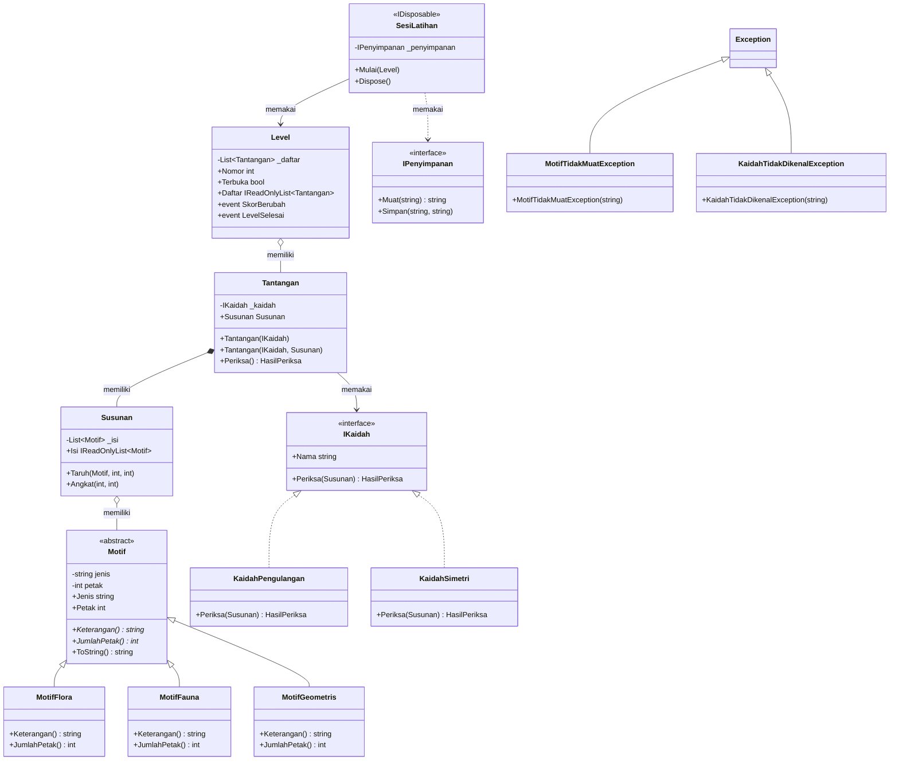

# TULIS_DI_SINI: nama aplikasi

> Baca `SOAL.md` dulu. Proposal dan Laporan Akhir dikumpulkan di Classroom (bukan di repo). Ganti semua `TULIS_DI_SINI` di berkas ini dan berkas catatan lain. Berkas yang masih memuat
> `TULIS_DI_SINI` dianggap belum diisi.

## Tautan

- Paket rilis (GitHub Releases, zip yang dapat langsung dijalankan): TULIS_DI_SINI

## Kelompok

| Nama | NRP | Akun GitHub |
|---|---|---|
| TULIS_DI_SINI | | |
| | | |
| | | |

## Ide dan pembeda

- Ide dalam satu kalimat: TULIS_DI_SINI
- Apa yang membuatnya berbeda dari aplikasi serupa lain: TULIS_DI_SINI

## Untuk guru

- Mata pelajaran dan jenjang: TULIS_DI_SINI
- Tujuan belajar: TULIS_DI_SINI
- Cakupan materi (dan sumber rujukannya): TULIS_DI_SINI
- Cara menjalankan dan memakai: TULIS_DI_SINI

## Rancangan

Jelaskan singkat arsitektur aplikasi dan pola desain yang dipakai (mis. Strategy untuk penilaian). Tempel diagram kelas (Mermaid)
yang cocok dengan kode.



TULIS_DI_SINI

## Cara menjalankan (untuk pengembang)

```bash
dotnet run --project src/Aplikasi     # menjalankan aplikasi
```

## Membuat paket rilis

```bash
dotnet publish src/Aplikasi -c Release -r win-x64 --self-contained true -o terbit
```

Kompres folder `terbit` menjadi zip, lalu unggah ke GitHub Releases di repo ini (tab Releases > Draft a new release).
Salin tautannya ke bagian **Tautan** di atas. Uji paket itu di komputer lain sebelum pos berikutnya.

## Status persyaratan

Isi dengan `selesai`, `sebagian`, atau `belum`.

| ID | Persyaratan | Status | Catatan |
|---|---|---|---|
| P1-P7 | Produk (ide, pedagogi, dapat dijalankan, progres, etika, uji coba, panduan) | TULIS_DI_SINI | |
| K1-K5 | Enkapsulasi, komposisi/pewarisan, polimorfisme, abstract/interface/DI, exception/life cycle | TULIS_DI_SINI | |
| K6 | Event | TULIS_DI_SINI | |
| K7 | Logika murni | TULIS_DI_SINI | |

## Yang belum selesai

TULIS_DI_SINI (tulis "tidak ada" bila semuanya selesai)
